# Architecture Loodi-mate MVP

Doc technique (état au 2026-11-13). Les diagrammes sont en Mermaid : ils s'affichent directement sur GitHub et dans Obsidian.

Sommaire :

1. [Vue d'ensemble](#1-vue-densemble)
2. [Couches du code](#2-couches-du-code)
3. [API serveur](#3-api-serveur)
4. [Parcours clés](#4-parcours-clés)
5. [Modèle de données Airtable](#5-modèle-de-données-airtable)
6. [Événements de mesure](#6-événements-de-mesure)
7. [Workflows n8n](#7-workflows-n8n)

---

## 1. Vue d'ensemble

Une PWA React (Vite) servie en statique par Vercel, et une seule fonction serveur (`api/router.ts`) qui reçoit tous les appels `/api/*`. Seule cette fonction détient les tokens Airtable et BGG. n8n lit la même base Airtable en tâche planifiée pour calculer H2 et envoyer le rapport hebdo.

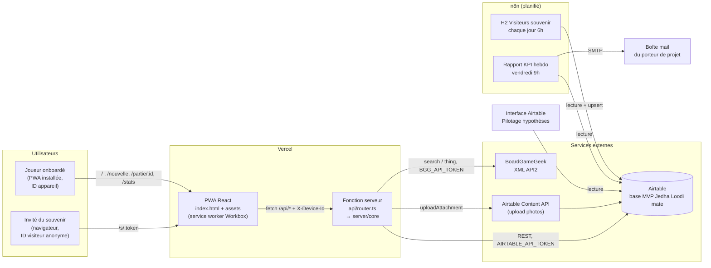

Routage Vercel (`vercel.json`) :

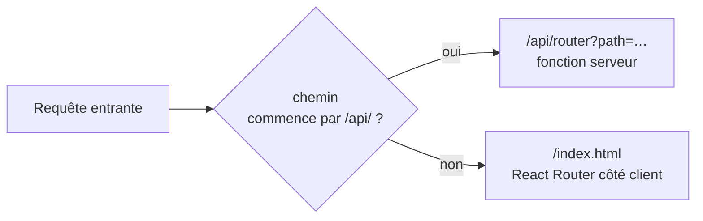

En dev, `dev/api-plugin.ts` branche le même `server/core` en middleware Vite : un seul code serveur pour local et production.

---

## 2. Couches du code

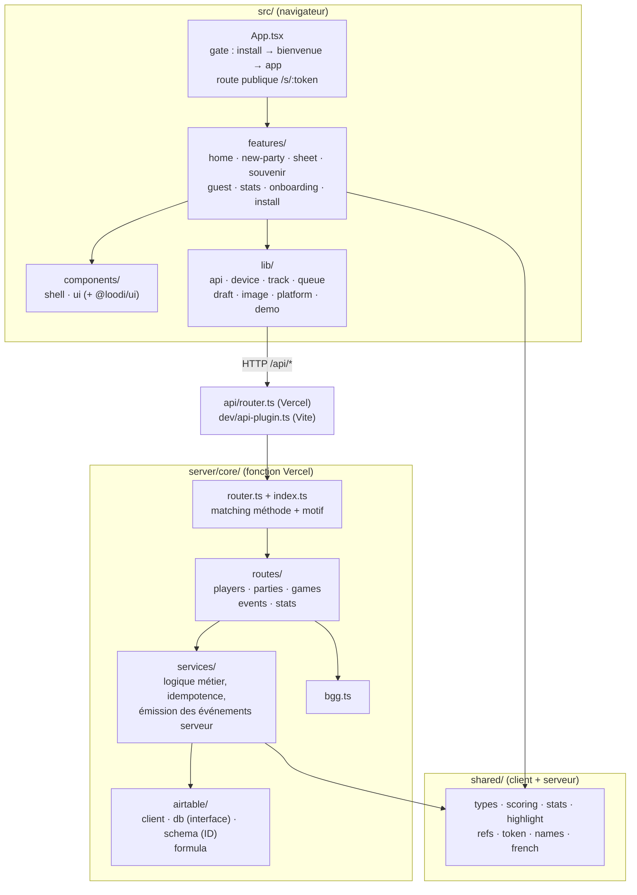

Points notables :

- `airtable/schema.ts` centralise les ID de tables et de champs (jamais les noms).
- `airtable/db.ts` est une interface : les tests serveur tournent sur `tests/helpers/fakeDb.ts`.
- `lib/device.ts` gère `mate.deviceId`, `mate.player` et `mate.visitorId` dans `localStorage`.
- `lib/queue.ts` sérialise les sauvegardes de feuille et le "Terminer" pour qu'ils arrivent dans l'ordre.
- `lib/image.ts` compresse les photos côté client (JPEG, 1600 px max, qualité 0,82) ; le serveur refuse au-delà de 5 Mo et de 3 photos.

---

## 3. API serveur

Toutes les routes passent par `server/core/router.ts`. L'identité vient de l'en-tête `X-Device-Id` ; seule `shared/:token` est publique (lecture du souvenir par jeton).

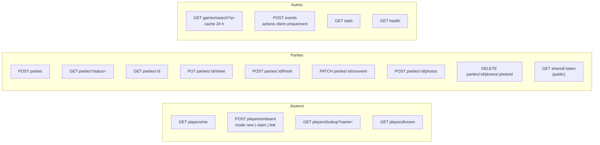

---

## 4. Parcours clés

### 4.1 Premier lancement et onboarding

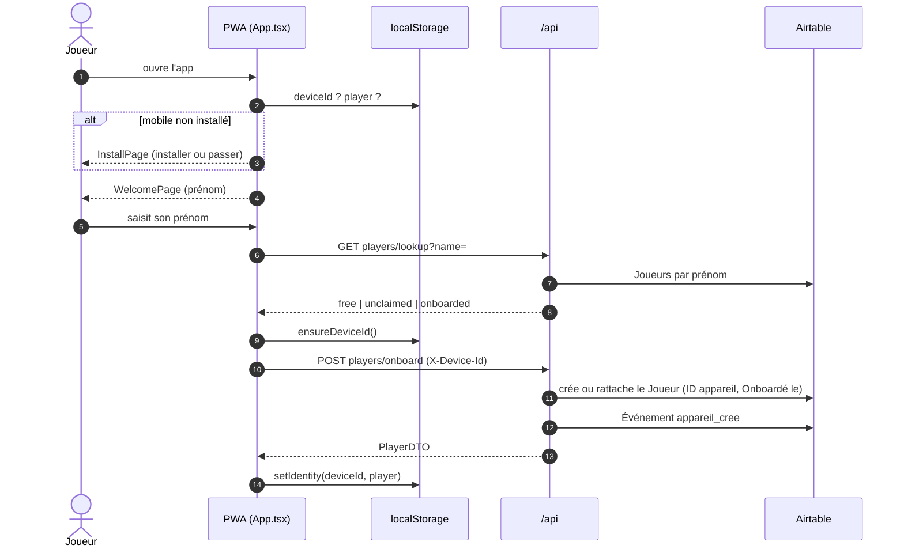

### 4.2 Créer, saisir et terminer une partie

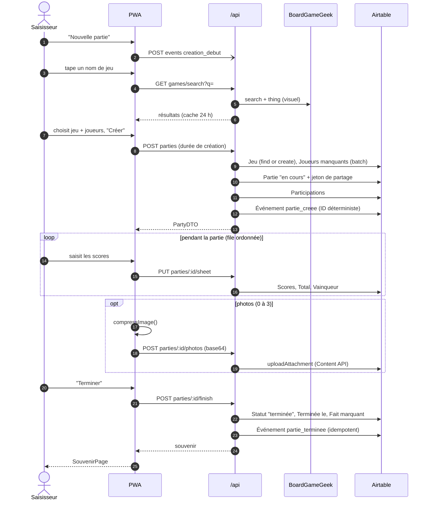

Idempotence : un nouvel essai de `POST parties` retrouve la partie déjà créée (même créateur, même jeu, mêmes joueurs) ; `finish` sur une partie déjà terminée renvoie le souvenir et garantit l'événement.

### 4.3 Partage et vue invité

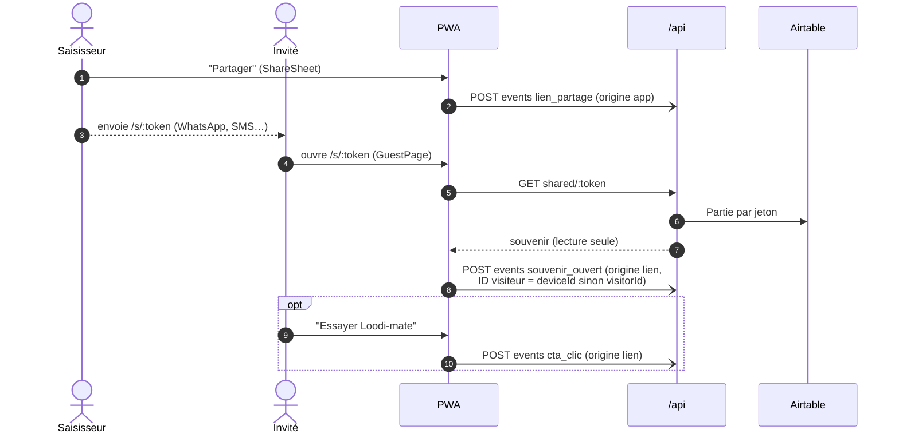

---

## 5. Modèle de données Airtable

Base `appTGUCdqHkz3EEbA`. Les champs calculés (KPI "Hx · …", "Filtre · …") ne sont jamais écrits par l'app.

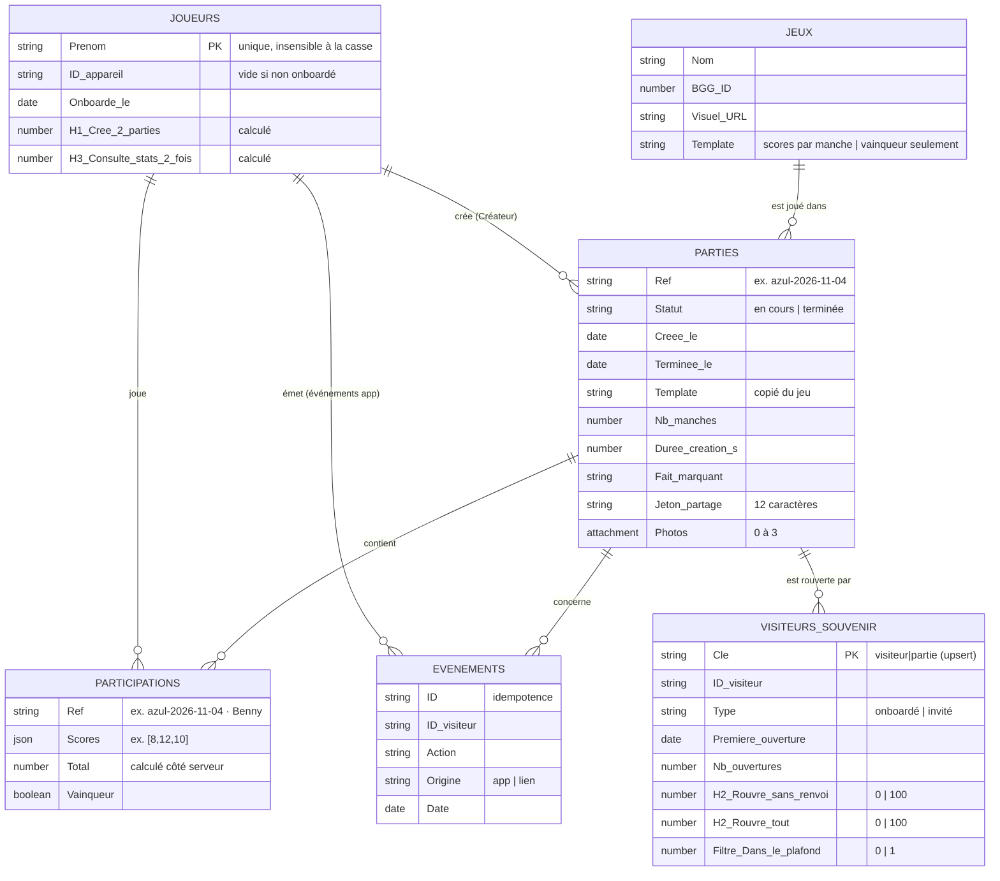

`Visiteurs souvenir` (`tblaj4pcEiOalng9Z`) n'est écrite que par n8n ; l'app ne la lit pas.

---

## 6. Événements de mesure

Les événements alimentent les hypothèses. Trois sont émis par le serveur (fiables, ID déterministe), cinq par le client via `lib/track.ts` (fire-and-forget, `keepalive`, un nouvel essai après 3 s avec le même ID ; le serveur déduplique sur l'ID).

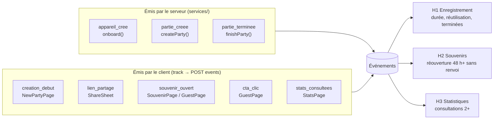

| Hypothèse | Événements utilisés | Calcul |
|---|---|---|
| H1 | `partie_creee`, `partie_terminee`, `cta_clic` | Champs calculés Airtable + rapport hebdo |
| H2 | `souvenir_ouvert`, `lien_partage` | Workflow n8n quotidien → `Visiteurs souvenir` |
| H3 | `stats_consultees` | Champs calculés sur `Joueurs` |

---

## 7. Workflows n8n

Exports dans `_n8n/`. Les deux workflows sont actifs et n'utilisent que des ID de base et de tables.

### 7.1 Enchaînement dans le temps

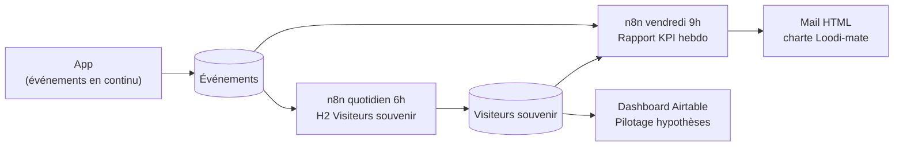

### 7.2 `Loodi-mate · H2 Visiteurs souvenir (quotidien)`

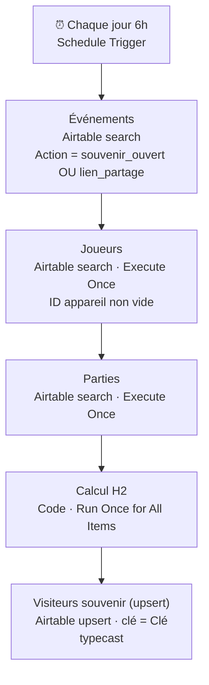

Logique du nœud `Calcul H2` :

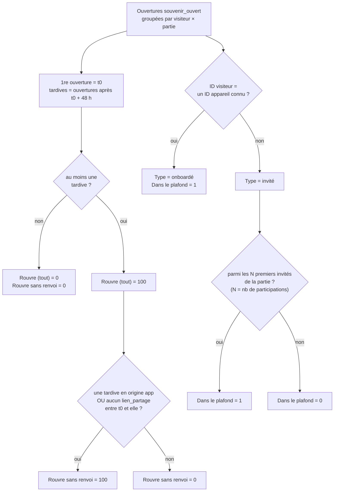

Le plafond évite qu'un lien très partagé gonfle H2 : on ne compte pas plus d'invités qu'il n'y avait de joueurs autour de la table. Le champ calculé `Filtre · 1re ouverture il y a 48 h+` (côté Airtable) écarte les lignes trop récentes pour être jugées.

### 7.3 `Loodi-mate - Rapport KPI hebdo`

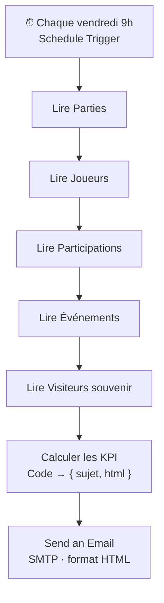

Les cinq lectures sont chaînées (Execute Once, Always Output Data) pour que le nœud Code puisse lire chacune par son nom via `$('…')`, même quand une table est vide.

Contenu du mail :

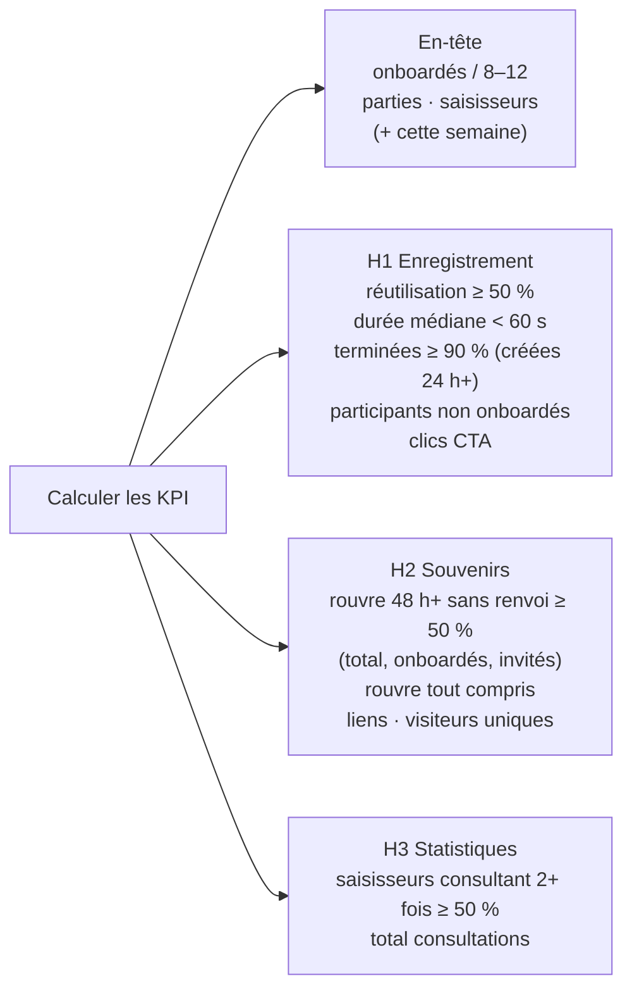

Chaque KPI porte une pastille "Seuil atteint", "Sous le seuil" ou "Pas encore de données", et son effectif `n` (effectifs faibles pendant le test).

À compléter dans n8n avant usage : `fromEmail` / `toEmail` (valeurs d'exemple dans l'export), credential SMTP, et `LOGO_URL` dans le nœud Code (PNG public, sinon pastille de repli).
